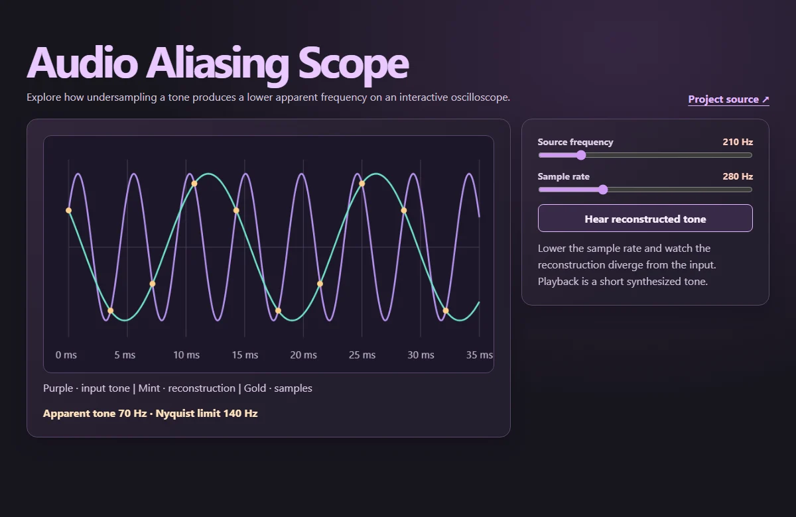

# Audio Aliasing Scope

Explore how undersampling a tone produces a lower apparent frequency on an interactive oscilloscope.

[Open the browser app](https://surfingcoder.com/apps/audio-aliasing-scope/)

## Run locally

Run the following command in this repository and open [localhost:8000](http://localhost:8000).

    python -m http.server 8000

For a sinusoid sampled at rate R, frequencies separated by an integer multiple of R produce the same sample sequence. The plot uses a signed frequency in the Nyquist interval to preserve sample phase. The playback uses the absolute pitch and generates audio only when requested.

## Verify

Run the following command with Node.js 22 or newer.

    node --test
